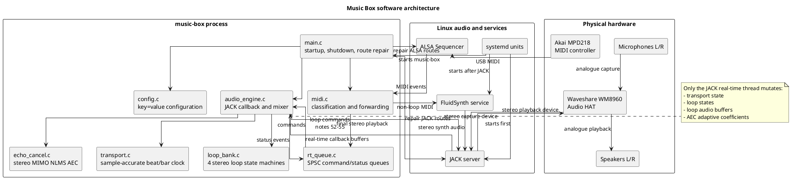
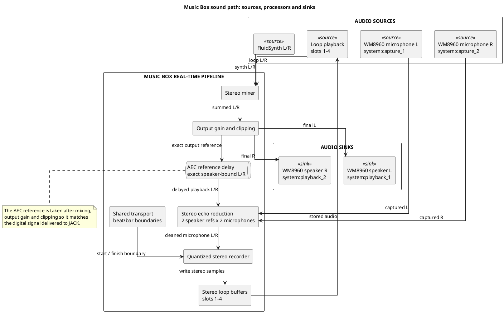
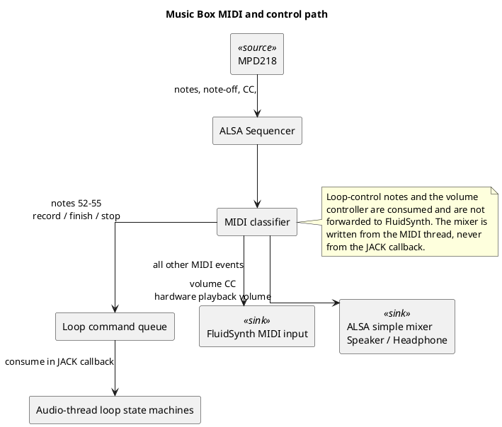
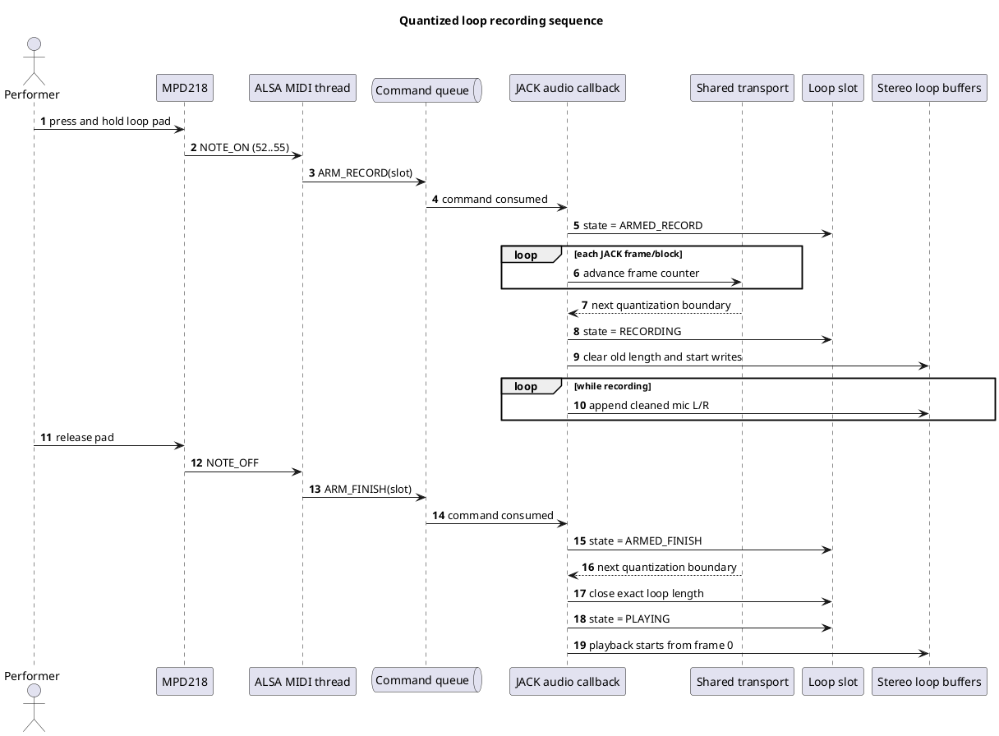
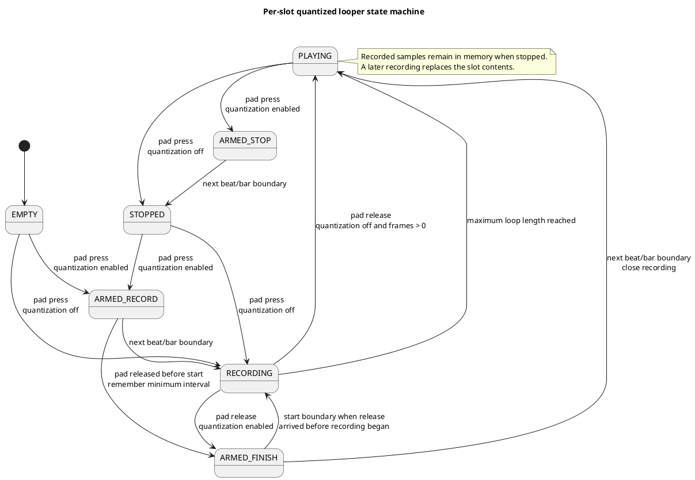

# Architecture

## Design goals

The implementation prioritises understandable C code, Raspberry Pi 3B compatibility, sample-accurate timing, no allocation/logging/locks in the JACK callback, and no vendored DSP or driver dependencies.

The diagrams in this document use PlantUML. GitHub displays the source blocks directly; they can be rendered with a PlantUML-capable editor, documentation generator, or the PlantUML CLI.

## System context

Music Box combines four external sources:

- Akai MPD218 MIDI events;
- WM8960 left microphone capture;
- WM8960 right microphone capture;
- FluidSynth stereo audio.

It produces three principal sinks:

- WM8960 left speaker output;
- WM8960 right speaker output;
- four stereo loop buffers in memory.

The final speaker-bound signal is also reused internally as the reference for acoustic echo reduction.

## Software architecture



## Module responsibilities

| Module | Responsibility |
|---|---|
| `main.c` | Startup, shutdown, event logging and route repair |
| `config.c` | Small `key=value` configuration parser |
| `midi.c` | ALSA sequencer ports, MPD discovery and MIDI forwarding |
| `audio_engine.c` | JACK callback, signal routing and final mixer |
| `transport.c` | Drift-free sample/beat/bar clock |
| `loop_bank.c` | Four stereo buffers and loop state machines |
| `echo_cancel.c` | Built-in two-reference/two-microphone NLMS AEC |
| `rt_queue.c` | Lock-free SPSC command and status queues |
| `volume.c` | ALSA simple-mixer hardware output volume driven by a MIDI knob |
| `display.c` | SSD1306 beat, recording-status and volume screens |

## Thread ownership

```text
ALSA MIDI thread                    JACK real-time thread
----------------                    ---------------------
read MIDI event                     drain command queue
classify loop note       queue      update transport
forward other MIDI     -------->    apply loop transitions
                                    mix synth and loops
                                    run stereo AEC
                         <--------   publish status event
print/log thread         queue      record clean microphone
```

The JACK callback is the only code allowed to mutate transport, loop buffers or loop states. Both queues are fixed-size single-producer/single-consumer rings using C11 atomics.

## Audio sources, internal processors and sinks

| Type | Name | Role |
|---|---|---|
| Source | `system:capture_1` | WM8960 left microphone |
| Source | `system:capture_2` | WM8960 right microphone |
| Source | `fluidsynth:l_00` | FluidSynth left channel |
| Source | `fluidsynth:r_00` | FluidSynth right channel |
| Source | Loop slots 1-4 | Previously recorded stereo playback |
| Processor | Echo canceller | Removes an estimate of speaker bleed from microphone capture |
| Processor | Quantized recorder | Writes cleaned microphone samples into an armed loop slot |
| Processor | Loop bank | Plays active loop slots phase-locked to their own stored length |
| Processor | Stereo mixer | Sums synth and loop playback |
| Processor | Output gain/clip | Produces the exact samples sent to the codec |
| Internal sink/source | AEC reference delay | Stores speaker-bound samples for later echo estimation |
| Sink | Loop buffers | Four stereo recordings held in memory |
| Sink | `system:playback_1` | WM8960 left playback channel |
| Sink | `system:playback_2` | WM8960 right playback channel |

## Sound path with sources and sinks



## JACK audio graph

FluidSynth is routed through Music Box rather than directly to playback:

```text
system:capture_1  -> music_box:mic_l
system:capture_2  -> music_box:mic_r
fluidsynth:l_00   -> music_box:synth_l
fluidsynth:r_00   -> music_box:synth_r
music_box:out_l   -> system:playback_1
music_box:out_r   -> system:playback_2
```

The final gain-adjusted/clipped speaker samples are the AEC reference. The AEC uses a configurable delay line because the matching acoustic echo appears in a later capture frame.

## MIDI and control path



## Transport

Tempo is stored in milli-BPM. Every audio frame adds `tempo_millibpm` to an integer accumulator. A beat occurs when it crosses `sample_rate * 60 * 1000`. At 48 kHz and 120 BPM this gives exactly 24,000 frames per beat and 96,000 per 4/4 bar. Fractional BPM values use rational accumulation rather than repeated floating-point rounding.

Frame zero is a beat/bar boundary and all slots share this transport.

## Quantized recording sequence

The MIDI thread only requests changes. The audio callback applies them at exact frame boundaries supplied by the shared transport.



A release received while still `ARMED_RECORD` is remembered. Recording begins at the next boundary and ends at the following boundary, producing one complete beat or bar. This also tends to keep the physical pad-tap transient before the recorded interval.

## Loop-slot state machine



## Built-in acoustic echo reduction

The implementation is a stereo MIMO normalized least-mean-square filter with four adaptive paths:

- left speaker reference to left microphone;
- right speaker reference to left microphone;
- left speaker reference to right microphone;
- right speaker reference to right microphone.

Coefficients adapt when there is enough reference energy and a simple double-talk guard does not detect disproportionate microphone energy.

It remains deliberately small and dependency-free. Limitations include manual delay tuning, linear-only modelling, simple double-talk handling and limited reverberation coverage. It is intended to reduce close-speaker bleed in the specific Music Box enclosure rather than provide telephony-grade room echo cancellation.

## Route maintenance

The application periodically repairs WM8960 capture/playback, FluidSynth JACK and MPD218/FluidSynth ALSA MIDI connections. This replaces the original shell polling service while preserving recovery after client restarts.

## Platform boundaries

The process itself depends only on libc, pthreads, JACK and ALSA. FluidSynth and the WM8960 kernel driver remain external components and keep their original licenses.

The same application architecture is used on current Raspberry Pi OS and on the original Raspberry Pi 3B environment. Differences involving old kernels, `/boot/config.txt`, legacy DKMS branches, JACK shared-memory cleanup and older FluidSynth behaviour are documented in `legacy-raspbian.md` rather than embedded in the real-time code.
